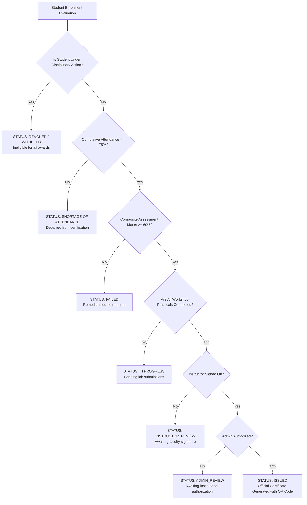

# Software Requirements Specification (SRS)
## Project: KISS Vocational Training Management System (NayiDisha VTMS)
**Standard Reference:** IEEE Std 830-1998 / ISO/IEC/IEEE 29148:2018  
**Version:** 1.0.0  
**Status:** Approved / Production Baseline  

---

## 1. Introduction

### 1.1 Purpose
This Software Requirements Specification (SRS) document defines the complete functional and non-functional requirements for the **KISS Vocational Training Management System (NayiDisha VTMS)**. The system is designed for the Kalinga Institute of Social Sciences (KISS) to provide structured, industry-aligned vocational education across 20 specialized trades, managing enrollment, practical workshop tracking, modular assessments, automated certification, and cryptographic QR verification.

### 1.2 Scope
NayiDisha VTMS encompasses:
- Web-based multi-role portal for Students, Instructors, Administrators, and Public Verifiers.
- Student admission, course catalog exploration (20 vocational trades), and batch enrollment.
- Biometric and manual session-by-session attendance tracking with institutional compliance rules.
- Practical assignment rubrics, tool requisitions, and hands-on task evaluations.
- Modular online assessments, automatic grade computation, and GPA calculation.
- Automated certificate eligibility evaluation, two-tier digital approval workflow, PDF generation, and public QR-code verification.
- Audit logging, analytics dashboards, and system-wide security settings.

### 1.3 Definitions, Acronyms, and Abbreviations
- **VTMS:** Vocational Training Management System.
- **KISS:** Kalinga Institute of Social Sciences.
- **SRS:** Software Requirements Specification.
- **IEEE:** Institute of Electrical and Electronics Engineers.
- **DFD:** Data Flow Diagram.
- **UML:** Unified Modeling Language.
- **RBAC:** Role-Based Access Control.
- **LOC:** Lines of Code.
- **FP:** Function Point.
- **COCOMO:** Constructive Cost Model.
- **SQA:** Software Quality Assurance.
- **QR:** Quick Response (cryptographically signed two-dimensional barcode).
- **MTBF:** Mean Time Between Failures.

### 1.4 References
- IEEE Std 830-1998: *IEEE Recommended Practice for Software Requirements Specifications*.
- ISO/IEC/IEEE 29148:2018: *Systems and software engineering — Life cycle processes — Requirements engineering*.
- National Skills Qualifications Framework (NSQF), Government of India guidelines for vocational curricula.

---

## 2. Overall Description

### 2.1 Product Perspective
NayiDisha VTMS is an autonomous, cloud-ready WebApp operating on a multi-tier client-server architecture:
- **Presentation Tier:** Next.js (React 19) with Tailwind CSS, responsive across mobile, tablet, and desktop devices.
- **Application/Business Logic Tier:** Next.js Server Actions, RBAC authorization handlers, decision-table rule engines.
- **Data Persistence Tier:** SQLite relational database managed via Prisma ORM with in-memory fallback stores.
- **Verification Gateway:** Public REST and SSR endpoints for zero-friction certificate verification.

### 2.2 User Characteristics
| User Role | Technical Competence | Key Responsibilities |
| :--- | :--- | :--- |
| **Student** | Novice to Intermediate | Browse courses, register, track attendance, submit assignments & practicals, attempt assessments, download certificates. |
| **Instructor** | Intermediate to Advanced | Manage class schedules, mark daily attendance, create assignments and practicals, evaluate submissions, approve certificates. |
| **Administrator** | Advanced | Oversee all courses, batches, and enrollments; review institutional analytics; approve/revoke certificates; audit logs. |
| **Public Verifier** | Novice | Scan QR code or enter Certificate ID to independently verify institutional credential authenticity. |

### 2.3 General Constraints
- System must function on modern web browsers (Chrome, Edge, Firefox, Safari) with zero browser plugins.
- Mobile-first responsive layout to support students accessing via low-cost Android smartphones.
- Zero data loss tolerance for official academic records and issued certificates.
- Fast certificate lookup (< 500 ms) via public QR scanning.

---

## 3. Specific Requirements

### 3.1 Functional Requirements (FR)

#### Subsystem 1: Authentication & Role-Based Access Control (RBAC)
- **FR-01:** The system shall authenticate users via Institutional ID / Email and password across three roles (`STUDENT`, `INSTRUCTOR`, `ADMIN`).
- **FR-02:** The system shall maintain secure HTTP-only session cookies with 7-day persistence and server-side validation.
- **FR-03:** The system shall provide one-click demo login capabilities for academic demonstration and faculty review.
- **FR-04:** The system shall restrict page routes and API actions strictly based on authorized user roles (`requireAuth`).

#### Subsystem 2: Course & Batch Management
- **FR-05:** The system shall manage 20 specialized vocational electives across 20 distinct trade categories.
- **FR-06:** Each course shall support modular curricula with learning objectives, contact hours, and downloadable resources.
- **FR-07:** The system shall permit Administrators to schedule time-bound batches with student capacity constraints.
- **FR-16 (Single-Trade Participation Rule):** The system shall strictly enforce that a student can only participate in ONE active vocational course at any given time. Any attempt to enroll a student who already has an active enrollment into another course shall be rejected with an informative policy violation message.
- **FR-17 (Enrollment Eligibility Pre-Check):** The system shall expose an active enrollment verification service (`canStudentEnroll`) returning the student's current enrollment status and active course details prior to executing enrollment mutations.

#### Subsystem 3: Attendance Tracking & Compliance
- **FR-08:** Instructors shall be capable of marking session-by-session attendance (`PRESENT`, `ABSENT`, `LATE`), including a one-click bulk option to mark all students present together.
- **FR-09:** The system shall automatically calculate cumulative attendance percentage per student per batch.
- **FR-10:** Students with cumulative attendance below **75%** shall be automatically flagged and rendered ineligible for certification.

#### Subsystem 4: Practicals, Assignments & Modular Assessments
- **FR-11:** Instructors shall create practical tasks with specific tool requirements and structured scoring rubrics.
- **FR-12:** Students shall upload digital proof of practical completion and receive graded feedback.
- **FR-13:** The system shall administer timed multiple-choice assessments and compute instant scoring and answer analysis.

#### Subsystem 5: Institutional Certification & Public Verification
- **FR-14:** The system shall implement a two-tier certificate approval pipeline:
  1. Automated eligibility check (Attendance $\ge 75\%$, Marks $\ge 60\%$, all practicals completed).
  2. Course Instructor sign-off $\rightarrow$ Institutional Admin final authorization.
- **FR-15:** Each issued certificate shall contain a unique institutional ID (e.g., `KISS-VT-2026-000421`) and an embedded QR code linking to an unalterable verification page (`/verify/[certificateId]`).

### 3.2 Business Requirements (BR)
- **BR-01 (Mission Alignment):** The platform shall support the foundational mandate of KISS: *"Eradicating hunger through Education"* via subsidized vocational skill development.
- **BR-10 (Single-Trade Specialization Policy):** Under KISS and National Skills Qualifications Framework (NSQF) guidelines, each student scholar must focus exclusively on one technical trade elective per academic session to ensure intensive workshop practice, laboratory safety, and guaranteed industry employability.

### 3.3 Non-Functional Requirements (NFR)

- **NFR-01 (Performance):** Dashboard and course catalog pages shall achieve Largest Contentful Paint (LCP) under 1.5 seconds on standard broadband connections.
- **NFR-02 (Reliability):** System availability shall be $\ge 99.8\%$ with automated session recovery.
- **NFR-03 (Security):** All input payloads shall be validated; password fields sanitized; sensitive actions logged in audit logs.
- **NFR-04 (Usability):** Institutional color scheme (#0b4f34 deep green, #c89d3c gold) adhering to WCAG 2.1 AA accessibility contrast guidelines.
- **NFR-05 (Maintainability):** Fully typed in TypeScript with strict compile checks and automated unit/integration test coverage.
- **NFR-06 (Portability):** Cross-platform execution across Linux, Windows, macOS, and containerized Docker environments.
- **NFR-07 (Data Invariant Integrity):** The database and business logic layer must guarantee the single-enrollment invariant: for every student $s$, $\sum \text{ActiveEnrollments}(s) \le 1$.
- **NFR-08 (Policy Transparency & Response Time):** When an enrollment is blocked by the single-course policy, the system shall return informative user feedback citing the active course within 200 ms.

---

## 4. Decision Tables and Decision Trees

### 4.1 Decision Table: Certificate Eligibility and Issuance Rules

| Condition / Criterion | Rule 1 | Rule 2 | Rule 3 | Rule 4 | Rule 5 | Rule 6 | Rule 7 | Rule 8 |
| :--- | :---: | :---: | :---: | :---: | :---: | :---: | :---: | :---: |
| **Attendance $\ge 75\%$** | Y | Y | Y | Y | N | N | Y | - |
| **Composite Score $\ge 60\%$** | Y | Y | Y | N | Y | N | - | - |
| **All Practicals Submitted** | Y | Y | N | - | - | - | - | - |
| **Instructor Approved** | Y | N | - | - | - | - | - | - |
| **Admin Approved** | Y | - | - | - | - | - | - | - |
| **Disciplinary Suspension Active**| N | N | N | N | N | N | Y | Y |
| **Action: Issue Certificate** | **X** | | | | | | | |
| **Action: Mark Eligible (Pending Approvals)** | | **X** | | | | | | |
| **Action: Hold (Pending Practicals)** | | | **X** | | | | | |
| **Action: Reject (Failing Grade)** | | | | **X** | | | | |
| **Action: Reject (Shortage of Attendance)**| | | | | **X** | **X** | | |
| **Action: Revoke / Withhold Certificate** | | | | | | | **X** | **X** |

### 4.2 Decision Tree: Academic Progression & Certification Logic

