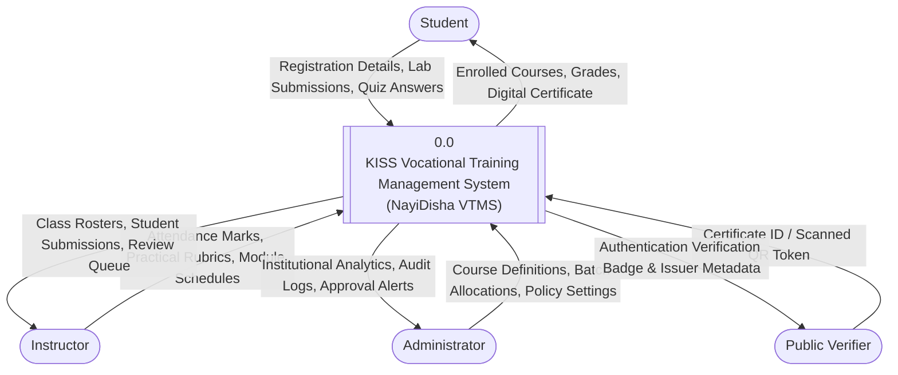
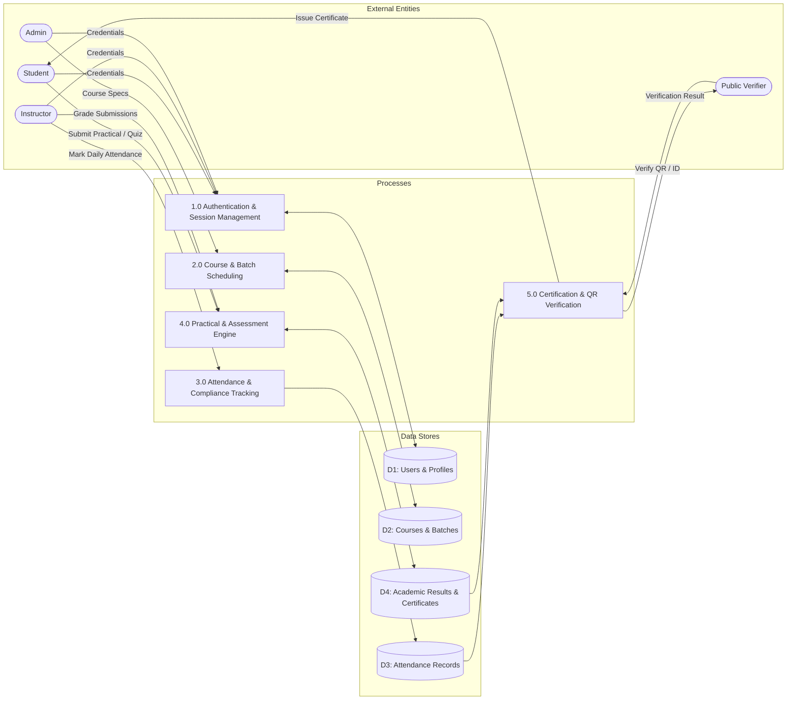
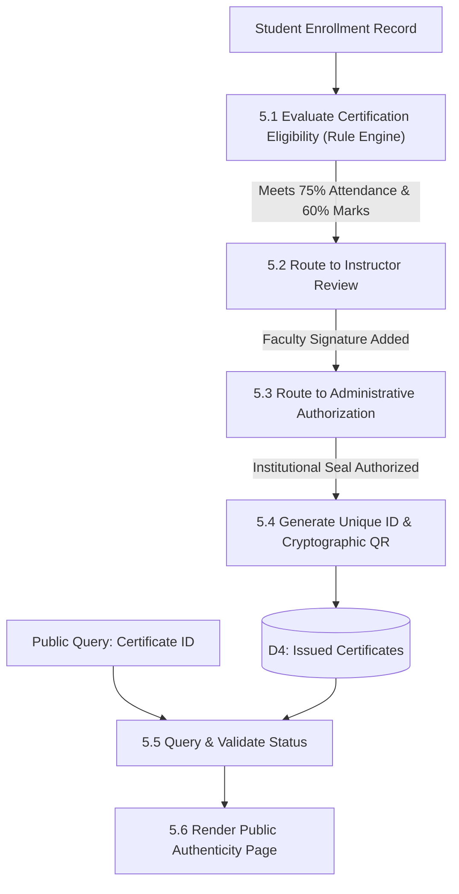
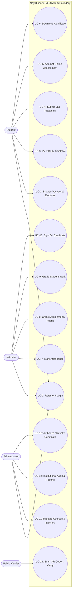
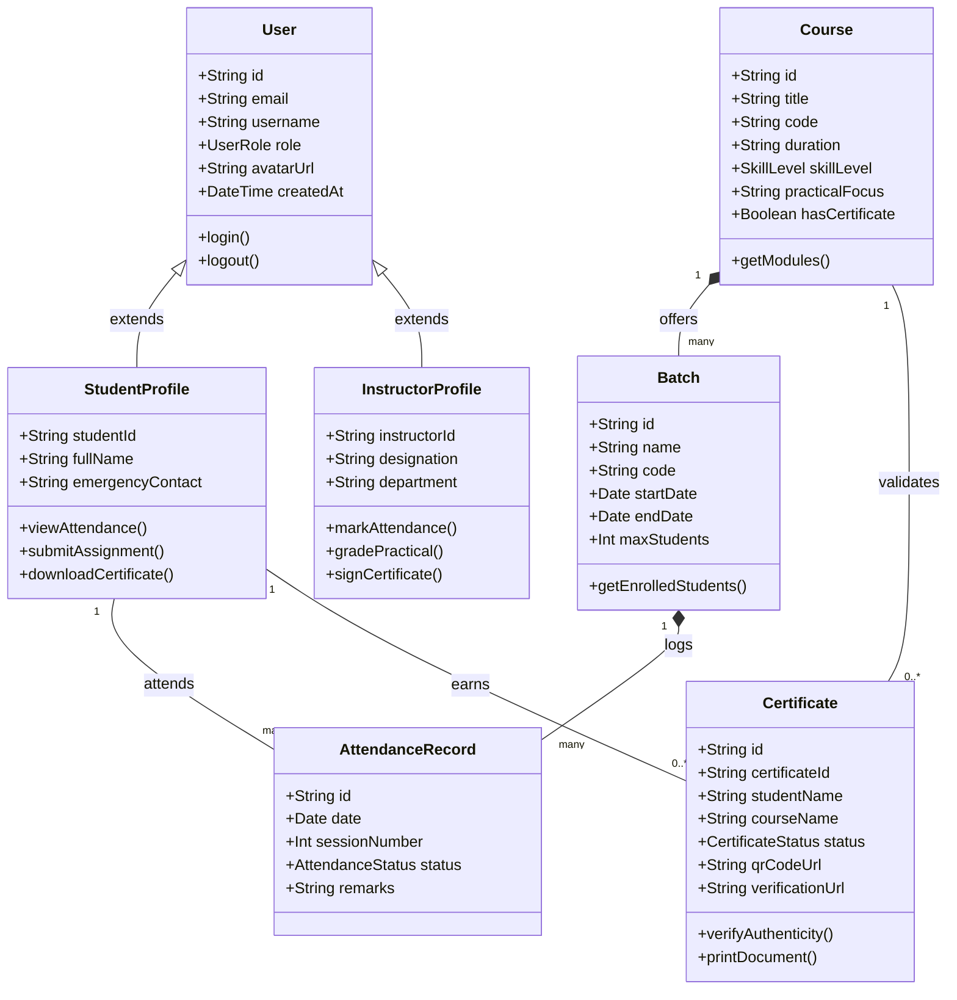
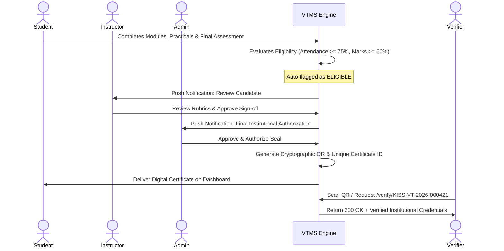
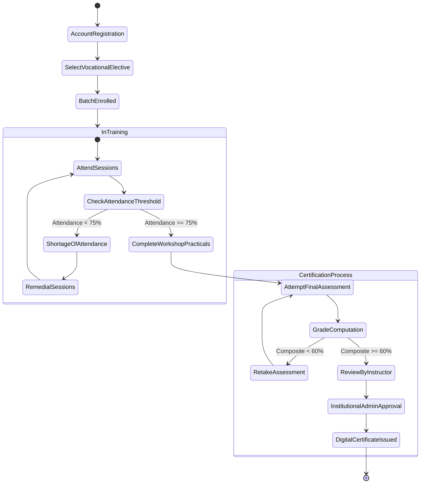

# Software Design Document (SDD)
## Project: KISS Vocational Training Management System (NayiDisha VTMS)
**Standard Reference:** IEEE Std 1016-2009 / Software Design Engineering  
**Version:** 1.0.0  
**Status:** Approved Architectural Baseline  

---

## 1. Overview of the Design Process

Software design transforms user requirements specified in the SRS into an implementable blueprint. The NayiDisha VTMS design follows a hybrid architectural methodology:
1. **High-Level Architectural Design:** Multi-tier decoupled WebApp architecture (Next.js App Router, Server Actions, Prisma ORM).
2. **Function-Oriented Structural Analysis:** Data Flow Diagrams (DFDs) modeling data transformation across functional processes.
3. **Object-Oriented Design (OOD):** UML models capturing encapsulation, class hierarchies, state transitions, and interaction dynamics.
4. **Interface & Interaction Design:** Component hierarchy, responsive viewport adaptation, and atomic design tokens.

---

## 2. Characterization of a Good Software Design

A good software design must exhibit three foundational pillars: **Understandability**, **Modifiability**, and **Efficiency**.

### 2.1 Cohesion Analysis
Cohesion measures the strength of functional relatedness among elements within a module.
- **Functional Cohesion (High - Achieved):** Every module and component performs a single, well-defined operational task:
  - `src/lib/auth/session.ts`: Dedicated solely to HTTP cookie lifecycle and RBAC authorization verification.
  - `src/lib/utils.ts`: Pure functional utilities for formatting (`formatDate`, `formatPercentage`, `cn`).
  - `src/components/certificates/CertificateDocument.tsx`: Isolated presentation component responsible solely for certificate rendering, watermark placement, and print optimization.
- **Avoidance of Low Cohesion:** Coincidental and logical cohesion anti-patterns are strictly eliminated.

### 2.2 Coupling Analysis
Coupling measures the degree of interdependence between software modules.
- **Data Coupling (Lowest / Best - Achieved):** Modules interact exclusively through clean parameter lists and strictly typed TypeScript interfaces (`types/index.ts`).
- **Elimination of Common/Control Coupling:** Global state mutation is eliminated; shared application state is managed through centralized database stores (`db-store.ts`) or SQLite tables.

| Metric | Target | Implemented Status | Architectural Benefit |
| :--- | :---: | :---: | :--- |
| **Cohesion** | High | **Functional Cohesion** | High reusability, isolated debugging, easy maintenance. |
| **Coupling** | Low | **Data Coupling** | Zero ripple effects when modifying individual UI routes. |

---

## 3. Function-Oriented Software Design (DFD Model)

### 3.1 DFD Level 0 (Context Level Diagram)
The Context Diagram establishes the boundary of the VTMS, representing external entities and top-level data inflows/outflows.

---

### 3.2 DFD Level 1 (Functional Decomposition Diagram)
Level 1 decomposes the system into five primary operational processes and four shared datastores.

---

### 3.3 DFD Level 2 (Certification & Verification Subsystem)

---

## 4. Object-Oriented Software Design (UML Models)

### 4.1 UML Use Case Diagram

---

### 4.2 UML Class Diagram

---

### 4.3 UML Sequence Diagram: Certificate Issuance and Public Verification

---

### 4.4 UML Activity Diagram: Student Course Lifecycle

---

## 5. User Interface (UI) WebApp Design

- **Grid Architecture:** 12-column responsive layout built on Tailwind CSS utility framework.
- **Institutional Palette:**
  - Primary Institutional Green: `#0b4f34`
  - Accent Gold: `#c89d3c`
  - Slate Background: `#f8fafc`
  - Emerald Status Indicators: `#10b981`
- **Responsive Breakpoints:** Fully tested at Mobile (375px), Tablet (768px), and Desktop (1280px+).
- **Print Styles:** Embedded print stylesheets (`@media print`) rendering A4-proportional official certificates with zero browser clutter.

