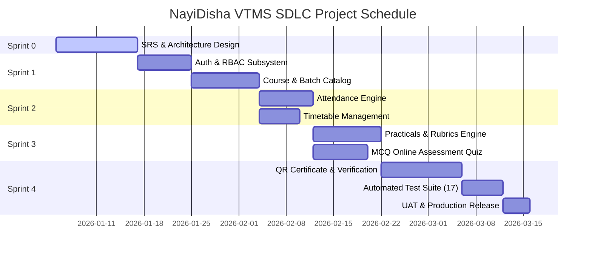

# Software Project Management Plan (SPMP)
## Project: KISS Vocational Training Management System (NayiDisha VTMS)
**Standard Reference:** IEEE Std 1058-1998 / Agile Project Management Framework  
**Version:** 1.0.0  
**SDLC Methodology:** Agile Scrum with Time-Boxed Sprints  

---

## 1. Project Management Complexity & Planning

The development of NayiDisha VTMS balances diverse stakeholder demands: high scalability for university-wide admissions, strict institutional compliance rules, zero-tamper cryptographic certificate generation, and an accessible interface for rural student populations.

### Agile Scrum Framework Implementation
The project was structured across **5 Sprints** of 2 weeks each:
- **Sprint 0 (Week 1–2):** Project charter, IEEE 830 SRS documentation, tech stack validation, database schema design.
- **Sprint 1 (Week 3–4):** Core authentication, session management, RBAC, base course catalog (20 trades).
- **Sprint 2 (Week 5–6):** Batch scheduling, timetable management, attendance tracking, and compliance threshold triggers.
- **Sprint 3 (Week 7–8):** Practical assignments, rubric scoring, multiple-choice quiz engine, and automated GPA calculation.
- **Sprint 4 (Week 9–10):** Cryptographic QR certificate generation, two-tier approval workflow, public `/verify` portal, automated test suite, and performance hardening.

### Definition of Done (DoD)
A User Story is marked **Done** only when:
1. TypeScript code compiles with zero errors (`npx tsc --noEmit`).
2. Unit and integration tests pass with 100% success rate (`npm test`).
3. UI passes responsive checks across 375px (mobile), 768px (tablet), and 1280px (desktop).
4. Peer code review passes inspection checklist.
5. Functional features are demonstrated and approved in the Sprint Review.

### 1.3 Scrum Backlog & Sprint User Stories

| Story ID | Persona & User Story | Story Points | Acceptance Criteria | DoD Status |
| :---: | :--- | :---: | :--- | :---: |
| **US-BR-10** | **As an Academic Director**, I want students to be restricted to exactly ONE active vocational course, so that students achieve intensive, distraction-free technical specialization under the KISS single-trade policy. | **3 SP** | 1. If a student is already enrolled in an active course, subsequent enrollment attempts throw an informative policy error. 2. `canStudentEnroll()` pre-check returns `canEnroll: false` and active course metadata. 3. Student course portal clearly reflects the 1 active course limit. | **DONE** (Verified by tests BR-10.1–10.3) |
| **US-FR-08B** | **As a Course Instructor**, I want a single-click "Mark All Present" button, so that I can quickly record 100% attendance on full attendance days without clicking each student row. | **2 SP** | 1. Prominent "Mark All Present" button placed above the student roster. 2. Header column shortcut to set all rows to present. 3. Real-time visual feedback confirming the bulk change. | **DONE** (Live in `/instructor/attendance`) |
| **US-FR-01B** | **As a Faculty Member**, I want to view my academic qualifications and edit my profile details, so that my professional credentials and contact details remain current. | **3 SP** | 1. Qualification prominently displayed in profile badge. 2. Edit form allowing full name, qualification, designation, department, and bio editing. 3. Changes persist to `db.instructors.update` with instant feedback. | **DONE** (Live in `/instructor/profile`) |

---

## 2. Metrics for Project Size Estimation

### 2.1 Lines of Code (LOC) Analysis
Using actual codebase measurement across source files:
- Front-end Pages & App Shell: ~3,400 LOC
- Domain Database Store & Mock Data: ~2,250 LOC
- Presentation Components & Logos: ~950 LOC
- Auth, Business Logic & Utilities: ~850 LOC
- Automated Test Suite: ~300 LOC
- Configuration & Styling: ~750 LOC
- **Total Effective Lines of Code:** **~8,500 LOC (8.5 KLOC)**

---

### 2.2 Function Point (FP) Metric Estimation
Function Point analysis measures software size based on functional units delivered to the user, independent of programming language.

#### Step 1: Unadjusted Function Points (UFP) Calculation

| Function Type | Description | Count | Complexity Weight (Average) | Weighted FP |
| :--- | :--- | :---: | :---: | :---: |
| **External Inputs (EI)** | Login, Register, Submit Attendance, Create Practical, Submit Lab, Take Quiz, Add Batch, Update Settings | 8 | 4 | 32 |
| **External Outputs (EO)** | Digital Certificate, Student Grade Report, Batch Attendance Sheet, Analytics KPI Cards, Audit Log Export | 5 | 5 | 25 |
| **External Inquiries (EQ)** | Search Course Catalog, Query Certificate Authenticity, Student Profile Lookup, Attendance Filter | 4 | 4 | 16 |
| **Internal Logical Files (ILF)**| Users, Courses, Batches, Enrollments, AttendanceRecords, Assessments, Certificates, SystemSettings | 8 | 10 | 80 |
| **External Interface Files (EIF)**| Institutional Image CDN, SMS/Email Alert Gateway, Biometric Device Integration | 3 | 7 | 21 |
| **Total Unadjusted Function Points (UFP)** | | | | **174** |

#### Step 2: Value Adjustment Factor (VAF) Calculation
Using the 14 General System Characteristics (GSCs), each scored on a scale of 0 to 5:
1. Data Communications: 4
2. Distributed Data Processing: 3
3. Performance Requirements: 4
4. Heavily Used Configuration: 3
5. Transaction Rate: 3
6. Online Data Entry: 5
7. End-User Efficiency: 4
8. Online Update: 4
9. Complex Processing: 3
10. Reusability: 4
11. Installation Ease: 3
12. Operational Ease: 4
13. Multiple Sites: 3
14. Facilitate Change: 4

$$\sum C_i = 4 + 3 + 4 + 3 + 3 + 5 + 4 + 4 + 3 + 4 + 3 + 4 + 3 + 4 = 51$$

$$VAF = 0.65 + (0.01 \times \sum C_i) = 0.65 + (0.01 \times 51) = 1.16$$

#### Step 3: Final Adjusted Function Points (AFP)

$$AFP = UFP \times VAF = 174 \times 1.16 = \mathbf{201.84\text{ FP}}$$

---

## 3. Project Estimation Techniques

### 3.1 Empirical Estimation: Wideband Delphi Technique
A panel of four senior software engineers and academic project leads conducted anonymous iterative estimation rounds:
- **Round 1 (Uninformed estimates):** 2.2 person-months, 3.8 person-months, 3.0 person-months, 2.8 person-months (Mean: 2.95).
- **Round 2 (After group discussion on complexity):** 2.7 person-months, 3.1 person-months, 2.9 person-months, 2.8 person-months.
- **Consensus Delphi Estimate:** **2.88 Person-Months (Approx. 460 working hours)**.

---

### 3.2 Heuristic Estimation: Basic & Intermediate COCOMO Models
For the NayiDisha VTMS system, the project classification is **Organic Mode** (small team, familiar domain, flexible requirements).

#### Basic COCOMO Formula:
- Effort: $E = a_b \times (KLOC)^{b_b}$
- Development Time: $D = c_b \times (E)^{d_b}$
- For Organic Mode: $a_b = 2.4$, $b_b = 1.05$, $c_b = 2.5$, $d_b = 0.38$

With $KLOC = 8.5$:

$$E = 2.4 \times (8.5)^{1.05} = 2.4 \times 9.489 = \mathbf{22.77\text{ Person-Months}}$$

$$D = 2.5 \times (22.77)^{0.38} = 2.5 \times 3.287 = \mathbf{8.22\text{ Months (for a single developer)}}$$

#### Team Staffing Level Estimation (Putnam's Model):
With an Agile team size of 3 engineers:

$$\text{Actual Project Duration} = \frac{E}{\text{Team Size}} = \frac{22.77}{3} \approx \mathbf{7.59\text{ weeks (Approx. 2 months)}}$$

Average Staffing Level:
$$S = \frac{E}{D} = \frac{22.77}{8.22} \approx \mathbf{2.77\text{ persons}} \approx \mathbf{3\text{ full-time software engineers}}$$

---

## 4. Scheduling, WBS, CPM & PERT Charts

### 4.1 Work Breakdown Structure (WBS)
- **1.0 Inception & Architecture**
  - 1.1 Stakeholder Requirement Workshops
  - 1.2 IEEE 830 SRS Document Creation
  - 1.3 Tech Stack & Database Schema Design
- **2.0 Core Infrastructure**
  - 2.1 Next.js App Router Scaffold
  - 2.2 Authentication & RBAC Engine
  - 2.3 Responsive AppShell & Navbar Layout
- **3.0 Academic & Training Modules**
  - 3.1 20-Trade Course Catalog & Syllabus
  - 3.2 Batch Allocation & Enrollment Actions
  - 3.3 Session Attendance Tracking Engine
- **4.0 Evaluation & Verification Modules**
  - 4.1 Lab Practical Rubric & Submissions
  - 4.2 Online Timed MCQ Quiz System
  - 4.3 Automated Grade & GPA Calculation
  - 4.4 Cryptographic QR Certificate Generator
  - 4.5 Public Certificate Verification Portal
- **5.0 Quality Assurance & Launch**
  - 5.1 Automated Unit/Integration Test Suite
  - 5.2 Performance & Security Audits
  - 5.3 User Acceptance Testing (UAT)

---

### 4.2 Critical Path Method (CPM) & PERT Analysis

| Activity | Description | Predecessor | Optimistic ($a$) | Most Likely ($m$) | Pessimistic ($b$) | Expected Time $T_e = \frac{a+4m+b}{6}$ |
| :---: | :--- | :---: | :---: | :---: | :---: | :---: |
| **A** | Requirements & SRS Specification | None | 4 days | 6 days | 14 days | **7.0 days** |
| **B** | Architecture & Schema Design | A | 3 days | 5 days | 7 days | **5.0 days** |
| **C** | Auth & Session Management | B | 3 days | 4 days | 5 days | **4.0 days** |
| **D** | Course & Batch Management | C | 4 days | 6 days | 8 days | **6.0 days** |
| **E** | Attendance Engine | D | 3 days | 5 days | 7 days | **5.0 days** |
| **F** | Practicals & Assessment Module | D | 4 days | 7 days | 10 days | **7.0 days** |
| **G** | Certificate Engine & QR Verification | E, F | 5 days | 8 days | 11 days | **8.0 days** |
| **H** | Test Suite & SQA Verification | G | 3 days | 4 days | 5 days | **4.0 days** |
| **I** | Final Deployment & UAT | H | 2 days | 3 days | 4 days | **3.0 days** |

#### Critical Path Identification:
$$\text{Path 1:} A \rightarrow B \rightarrow C \rightarrow D \rightarrow E \rightarrow G \rightarrow H \rightarrow I = 7 + 5 + 4 + 6 + 5 + 8 + 4 + 3 = \mathbf{42\text{ days}}$$
$$\text{Path 2:} A \rightarrow B \rightarrow C \rightarrow D \rightarrow F \rightarrow G \rightarrow H \rightarrow I = 7 + 5 + 4 + 6 + 7 + 8 + 4 + 3 = \mathbf{44\text{ days (CRITICAL PATH)}}$$

The **Critical Path** is **A $\rightarrow$ B $\rightarrow$ C $\rightarrow$ D $\rightarrow$ F $\rightarrow$ G $\rightarrow$ H $\rightarrow$ I** with a total duration of **44 working days**.

---

### 4.3 Gantt Chart Representation

---

## 5. Risk Management Plan (RMMM Matrix)

| Risk ID | Risk Description | Category | Prob. | Impact | Risk Score | Mitigation & Management Strategy |
| :---: | :--- | :---: | :---: | :---: | :---: | :--- |
| **R-01** | Student attendance tampering | Security | Low | High | **Medium** | Biometric validation, immutable database logs, instructor audit records. |
| **R-02** | Fraudulent certificate generation | Security | Low | Critical | **High** | Two-tier approval (Instructor + Admin) with cryptographic QR token verification. |
| **R-03** | Server performance bottleneck during exams | Technical | Med | High | **High** | Edge caching with Next.js SSR, lightweight state store, lazy asset loading. |
| **R-04** | Rural student device incompatibility | Usability | High | Med | **High** | Zero plugin architecture, tested responsive layouts down to 375px screens. |
| **R-05** | Requirements scope creep | Project | Med | Med | **Medium** | Strict 2-week time-boxed Agile sprints and clear Definition of Done. |

